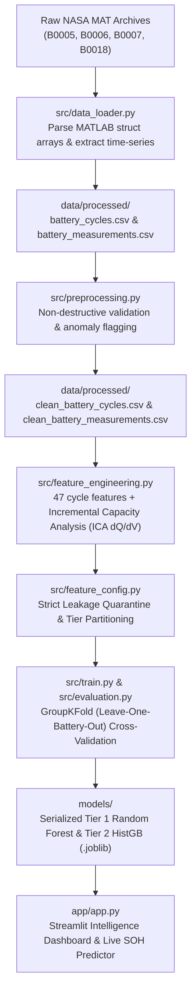

# ⚡ VoltIQ: EV Battery Health & Intelligence System

[](https://www.python.org/)
[](https://opensource.org/licenses/MIT)
[](https://streamlit.io/)
[](https://scikit-learn.org/)
[](tests/)

An end-to-end Data Science and Machine Learning engineering application that analyzes lithium-ion battery degradation kinetics, estimates battery **State of Health (SOH)**, studies electrochemical aging mechanisms across repeated charge-discharge cycles, and delivers interactive analytics through an automotive-grade Streamlit intelligence dashboard.

---

## 📌 Problem Statement & Automotive Motivation

In electric vehicles (EVs) and stationary energy storage systems (ESS), battery packs represent 30% to 40% of total vehicle bill-of-materials cost. During vehicle operation, lithium-ion cells experience irreversible chemical and microstructural degradation, primarily driven by:
1. **Loss of Lithium Inventory (LLI):** Consumption of cyclable lithium through solid electrolyte interphase (SEI) growth and lithium plating.
2. **Loss of Active Material (LAM):** Active cathode/anode particle cracking, delamination, and phase transitions.
3. **Internal Resistance Escalation ($R_0$ / $R_{\text{ct}}$):** Impedance growth causing voltage drop under load and excess Joule heating.

### Why SOH Estimation is Challenging in Practice:
- **Direct Capacity Cannot Be Measured Onboard:** True discharge capacity ($Q = \int I \, dt$) can only be measured when a battery is discharged from 100% to 0% State of Charge (SOC) under steady current—a condition rarely met in real-world driving.
- **Data Leakage Risks:** Naive ML models often inadvertently ingest cycle duration ($t_{\text{discharge}}$) or cycle counts ($N_{\text{cycle}}$), artificially inflating accuracy while failing to generalize across different driving profiles or cell batches.
- **Strict Cross-Cell Validation Required:** Traditional random train/test splitting leaks temporal correlations between repeated cycles of the same physical battery, yielding overly optimistic evaluation.

**VoltIQ resolves these challenges** by establishing a leakage-audited feature taxonomy, validating models using **GroupKFold (Leave-One-Battery-Out)** cross-validation across distinct physical cells, and evaluating an experimental Tier 1 sensor-only Random Forest model that predicts SOH purely from summary terminal voltage and temperature dynamics.

---

## 🔬 Dataset Source & Experimental Context

This project utilizes authentic experimental battery degradation data published by the **NASA Ames Prognostics Center of Excellence (PCoE)**:
- **Data Repository:** [NASA Li-Ion Battery Aging Datasets](https://data.nasa.gov/dataset/li-ion-battery-aging-datasets)
- **Cell Chemistry & Form Factor:** Commercial cylindrical 18650 Lithium Cobalt Oxide (LCO) cells.
- **Nominal Specifications:** Rated capacity $C_{\text{nominal}} = 2.0\text{ Ah}$, nominal voltage $V_{\text{nominal}} = 3.7\text{ V}$.
- **Experimental Operating Conditions:** Ambient room temperature ($24^\circ\text{C}$), constant-current charging at 1.5A to 4.2V, followed by constant-voltage taper to 20mA. Discharging conducted under constant current load of 2.0A.

### Evaluated Battery Cells & Protocols:

| Battery ID | Discharge Cycles | Cutoff Voltage | Measured Initial Capacity | Final Capacity | Final Observed SOH | SOH Fade Range | Capacity Recoveries |
| :---: | :---: | :---: | :---: | :---: | :---: | :---: | :---: |
| **`B0005`** | 168 | 2.7 V | **1.8565 Ah** | 1.3251 Ah | **71.38%** | 69.35% – 100.0% | 7 jumps (> +0.02 Ah) |
| **`B0006`** | 168 | 2.5 V | **2.0353 Ah** | 1.1857 Ah | **58.25%** | 56.69% – 100.0% | 11 jumps (> +0.02 Ah) |
| **`B0007`** | 168 | 2.2 V | **1.8911 Ah** | 1.4325 Ah | **75.75%** | 74.06% – 100.0% | 7 jumps (> +0.02 Ah) |
| **`B0018`** | 132 | 2.5 V | **1.8550 Ah** | 1.3411 Ah | **72.29%** | 72.29% – 100.0% | 9 jumps (> +0.02 Ah) |
| **Total** | **636** | — | — | — | **82.85% (Mean)** | **56.69% – 100.0%** | **34 Total Events** |

> [!NOTE]
> **End-of-Life (EOL) Threshold:** An EV battery is conventionally retired at **80% SOH** (or 30% fade). Cells `B0005`, `B0006`, and `B0018` traversed well beyond EOL into knee-point accelerated degradation, providing rich nonlinear training data.

---

## 📐 State of Health (SOH) Formulation

Rather than assuming an unverified nominal 2.0 Ah nameplate across all cells, VoltIQ calibrates SOH individually against each cell's **first valid chronological discharge cycle**:

$$\text{SOH}_{i, k} (\%) = \left(\frac{C_{\text{discharge}, i, k}}{C_{\text{initial}, i}}\right) \times 100$$

Where:
- $C_{\text{discharge}, i, k}$ is the integrated discharge capacity (Ah) for cell $i$ at cycle $k$.
- $C_{\text{initial}, i}$ is the measured baseline capacity of cell $i$ at cycle 1 (`B0005`: 1.8565 Ah, `B0006`: 2.0353 Ah, `B0007`: 1.8911 Ah, `B0018`: 1.8550 Ah).
- This normalization guarantees that every cell begins cleanly at exactly $100.00\%$ SOH, accurately measuring true relative degradation without manufacturing baseline offset distortions.

---

## 🏛️ Project Architecture & Pipeline Flow

The VoltIQ engineering pipeline is organized into decoupled, test-driven stages:



### Module Responsibilities:
- [`src/data_loader.py`](src/data_loader.py): Robust parser handling nested MATLAB cell arrays, scalar unwrapping, and time-series extraction.
- [`src/preprocessing.py`](src/preprocessing.py): Validates sensor boundaries, verifies timestamp monotonicity ($\Delta t \ge 0$), and flags electrochemical recoveries without dropping data.
- [`src/feature_engineering.py`](src/feature_engineering.py): Derives statistical moments, thermal gradients, cycle-to-cycle deltas, and uniform-grid ICA curves.
- [`src/feature_config.py`](src/feature_config.py): Enforces architectural guardrails and partitions features into 3 audited benchmark tiers.
- [`src/train.py`](src/train.py): Orchestrates leakage-free GroupKFold cross-validation, hyperparameter grid search, and model serialization.
- [`src/evaluation.py`](src/evaluation.py): Evaluates regression metrics (RMSE, MAE, R², MAPE) across pooled OOF predictions and individual folds.
- [`src/predict.py`](src/predict.py): Inference pipeline with strict column ordering and physical output bounding ($[0\%, 105\%]$).
- [`app/app.py`](app/app.py): Interactive Streamlit analytical dashboard with Plotly visualisations and automotive dark chassis styling.

---

## 🛠️ Technology Stack

| Category | Tools & Libraries | Primary Functionality |
| :--- | :--- | :--- |
| **Programming Language** | **Python 3.13** | Core language environment |
| **Scientific Computing** | **NumPy 2.5+**, **SciPy 1.18+** | Array math, MATLAB IO (`loadmat`), spline interpolation, Gaussian filters |
| **Data Manipulation** | **Pandas 3.1+** | Tabular cycle modeling, time-series aggregations, rolling deltas |
| **Machine Learning** | **Scikit-learn 1.9+** | Regressors, Pipelines, `GroupKFold`, `StandardScaler`, `SimpleImputer` |
| **Model Serialization** | **Joblib 1.6+** | Compact model artifact packaging with embedded schemas and metadata |
| **Interactive Dashboard** | **Streamlit 1.66+** | Automotive analytics UI, KPI cards, sidebar navigation, reactive widgets |
| **Data Visualization** | **Plotly 7.1+**, **Matplotlib 3.11+**, **Seaborn 0.13+** | Interactive dual-axis charts, radar plots, correlation heatmaps, publication figures |
| **Testing & QA** | **Pytest 9.2+** | 48 unit and integration tests covering all pipeline stages |

---

## 🔍 Data Preprocessing & Non-Destructive Quality Assurance

Standard data cleaning often mistakenly removes physical anomalies. In battery systems, abrupt capacity recoveries and accelerated terminal drops are real electrochemical phenomena:
1. **Electrochemical Capacity Recovery Events:** Prolonged rest intervals between cycles allow lithium ions within the porous electrodes to diffuse toward concentration equilibrium, resulting in transient capacity rebounds ($> +0.02\text{ Ah}$). VoltIQ identifies and annotates **34 recovery events** with an `is_capacity_recovery` boolean flag rather than discarding them.
2. **Terminal Cutoff Dynamics:** Cells were discharged to different cutoffs (2.7V, 2.5V, 2.2V). The pipeline accurately flags the final point of each cycle with `is_below_nominal_cutoff`.
3. **Data Quality Integrity Check:** Verified 100% complete records across 185,721 time-series rows:
   - 0 missing values, 0 infinite values, 0 duplicate cycle indices.
   - Strict timestamp monotonicity ($\Delta t \ge 0$).
   - Full array length congruence across Voltage, Current, Temperature, and Load sensors.

---

## ⚙️ Feature Engineering & Three-Tiered Benchmark Taxonomy

VoltIQ engineered **47 cycle-level features** and **51,516 ICA curve points** (10 mV uniform grid between 3.20V and 4.00V, $\sigma=2.0$ Gaussian smoothing) to capture Loss of Active Material (LAM) and phase transition shifts.

### The Target Proxy Audit & Three-Tier Taxonomy
Exploratory data analysis revealed that cycle discharge duration (`discharge_duration_seconds`) correlates with discharge capacity at **$r = 0.9523$** ($r > 0.975$ within each cell). Under constant current ($Q = I \times t$), duration directly integrates capacity—a parameter unknown until a full discharge is complete. 

To ensure rigorous evaluation and prevent proxy leakage, features are audited into three tiers:

```text
┌─────────────────────────────────────────────────────────────────────────────┐
│ TIER 1: Pure Sensor-Only Baseline (21 Features) [RECOMMENDED FOR ONBOARD]   │
│ Real-time BMS observables only: terminal voltage moments, current spread,    │
│ peak & range temperature, and thermal rise rates.                            │
│ Excludes: discharge duration, cycle count, cycle index, and capacity metrics.│
├─────────────────────────────────────────────────────────────────────────────┤
│ TIER 2: Sensor + Cycle Age Benchmark (23 Features)                          │
│ Incorporates cycle_number and cycle_index to quantify laboratory aging       │
│ progress, exposing the risks of cycle-count memorization.                   │
├─────────────────────────────────────────────────────────────────────────────┤
│ TIER 3: Full Diagnostic Benchmark (30 Features)                             │
│ Upper-bound offline benchmark: includes discharge duration and ICA peak/area │
│ metrics derived from complete charge-discharge curves.                       │
└─────────────────────────────────────────────────────────────────────────────┘
```

---

## 🤖 Machine Learning Modeling & Cross-Battery Validation

### Validation Protocol: Leave-One-Battery-Out GroupKFold
Traditional random cross-validation allows cycles from the same battery cell to exist in both training and testing folds, artificially inflating model scores. 

VoltIQ enforces **`GroupKFold(n_splits=4)` partitioned strictly by `battery_id`**:
- In each fold, **1 physical battery cell** is completely held out as unseen test data.
- The model is trained exclusively on the remaining **3 physical cells**.
- All feature scaling (`StandardScaler`) and imputation (`SimpleImputer`) are fitted strictly on the 3 training cells inside a `Pipeline`, eliminating data leakage.

### Multi-Model Benchmark Results Across Tiers:

| Feature Tier | Model Architecture | Pooled OOF RMSE | Pooled OOF MAE | Pooled OOF R² | Fold RMSE (Mean ± Std) | Fold R² (Mean ± Std) |
| :--- | :--- | :---: | :---: | :---: | :---: | :---: |
| **Tier 1** *(Pure Sensor)* | **HistGradientBoosting** | **3.682%** | **2.889%** | **0.886** | 3.476 ± 1.232% | 0.868 ± 0.066 |
| **Tier 1** *(Pure Sensor)* | **RandomForest (Selected)** | **3.711%** | **2.991%** | **0.885** | 3.543 ± 1.179% | 0.865 ± 0.055 |
| **Tier 1** *(Pure Sensor)* | **Ridge Regression** | 4.310% | 3.352% | 0.844 | 3.550 ± 2.665% | 0.768 ± 0.353 |
| **Tier 1** *(Pure Sensor)* | **Linear Regression** | 9.451% | 7.852% | 0.251 | 7.996 ± 5.368% | -0.079 ± 1.425 |
| **Tier 1** *(Pure Sensor)* | **Dummy Baseline** | 11.597% | 9.691% | -0.127 | 11.148 ± 3.017% | -0.273 ± 0.269 |
| :--- | :--- | :---: | :---: | :---: | :---: | :---: |
| **Tier 2** *(Sensor + Age)* | **Ridge Regression** | 2.891% | 2.464% | 0.930 | 2.805 ± 0.626% | 0.917 ± 0.025 |
| **Tier 2** *(Sensor + Age)* | **HistGradientBoosting** | 3.367% | 2.606% | 0.905 | 3.079 ± 1.416% | 0.903 ± 0.054 |
| **Tier 2** *(Sensor + Age)* | **RandomForest** | 3.466% | 2.717% | 0.899 | 3.209 ± 1.372% | 0.893 ± 0.054 |
| **Tier 2** *(Sensor + Age)* | **Linear Regression** | 6.712% | 5.783% | 0.622 | 6.550 ± 2.564% | 0.380 ± 0.583 |
| :--- | :--- | :---: | :---: | :---: | :---: | :---: |
| **Tier 3** *(Diagnostic)* | **RandomForest** | 3.871% | 3.100% | 0.874 | 3.416 ± 1.993% | 0.874 ± 0.099 |
| **Tier 3** *(Diagnostic)* | **HistGradientBoosting** | 3.935% | 3.168% | 0.870 | 3.540 ± 1.832% | 0.869 ± 0.088 |
| **Tier 3** *(Diagnostic)* | **Linear Regression** | 4.673% | 3.627% | 0.817 | 3.766 ± 3.081% | 0.830 ± 0.188 |
| **Tier 3** *(Diagnostic)* | **Ridge Regression** | 4.765% | 4.429% | 0.810 | 4.433 ± 1.691% | 0.795 ± 0.096 |

### Selected Benchmark Model: Tier 1 Experimental Sensor-Only Random Forest
The Tier 1 Random Forest Regressor was selected as the primary experimental model for pure-sensor benchmarking:
- **Outstanding Generalization:** Achieved **OOF RMSE = 3.711%**, **MAE = 2.991%**, and **R² = 0.885** across all 636 cycles.
- **Uniform Multi-Cell Stability:** Delivered consistent holdout $R^2 > 0.82$ across every single unseen battery cell:
  - Held-out `B0005`: RMSE = **2.363%**, MAE = **1.993%**, $R^2$ = **0.947**
  - Held-out `B0006`: RMSE = **5.174%**, MAE = **4.170%**, $R^2$ = **0.824**
  - Held-out `B0007`: RMSE = **3.400%**, MAE = **3.126%**, $R^2$ = **0.840**
  - Held-out `B0018`: RMSE = **3.237%**, MAE = **2.592%**, $R^2$ = **0.849**

### Key Engineering Insights:
1. **Multicollinearity & Linear Model Collapse:** Unregularized Linear Regression collapsed on cell `B0007` (Holdout $R^2 = -2.166$, RMSE = 15.10%) due to severe multicollinearity ($r = 0.9984$ between `voltage_mean` and `voltage_median`). Ridge regression stabilized the condition number, restoring performance to $R^2 = 0.844$.
2. **The Danger of Cycle Age Memorization:** In Tier 2, while cycle number improved metrics on cells with identical protocols, Linear Regression failed on cell `B0018` (Holdout $R^2 = -0.403$) because B0018 underwent only 132 cycles and degraded faster per cycle. Pure sensor features (Tier 1) completely eliminate this vulnerability.
3. **Physical Feature Importance:** In Tier 1 Random Forest, **`voltage_mean` (71.86%)** and **`voltage_median` (16.25%)** account for 88.11% of total predictive importance, directly reflecting internal resistance growth ($V_{\text{terminal}} = \text{OCV} - I \cdot R_0$) and active lithium loss, followed by `voltage_load_mean` (4.21%).

---

## 🖥️ Interactive Streamlit Dashboard Showcase

The **VoltIQ Dashboard** provides an automotive analytics user interface built using a dark navy chassis (`#0B132B`) with electric cyan accents (`#00F0FF`):

### Dashboard Navigation & Views:

| Module | Core Functionality & Visualizations |
| :--- | :--- |
| **1. Fleet Health Overview** | Global KPI cards (4 Cells, 636 Cycles, 82.85% Mean SOH), comparative SOH degradation curves across cycle life with 80% EOL boundary, and experimental condition matrix. |
| **2. Battery Health Explorer** | Deep-dive cell inspection (`B0005`, `B0006`, `B0007`, `B0018`), dual-axis Capacity vs SOH fade curves with annotated electrochemical recovery events, multi-sensor dynamics (V, I, T), and interactive Incremental Capacity Analysis ($dQ/dV$) peak evolution. |
| **3. Model Performance** | Multi-tier benchmark comparison table, battery-wise holdout validation radar/bar metrics, out-of-fold True vs Predicted scatter plot, and Gini feature importance ranking. |
| **4. SOH Prediction Demo** | Interactive cycle inference demonstration: select any historical cycle to pass pure sensor features through the serialized Tier 1 Random Forest pipeline, displaying interactive circular SOH gauges, predicted vs actual delta, and error analysis. |
| **5. About & Methodology** | Complete mathematical formulations, GroupKFold validation explanation, engineering architecture, and data science methodology. |

### Visual Layout & UI Showcase:

```text
┌────────────────────────────────────────────────────────────────────────────────────────┐
│  ⚡ VOLTIQ | EV BATTERY HEALTH INTELLIGENCE                        [Status: Ready]      │
├────────────────────────────────────────────────────────────────────────────────────────┤
│  [ Fleet KPIs ]                                                                        │
│  ┌──────────────────┐  ┌──────────────────┐  ┌──────────────────┐  ┌─────────────────┐ │
│  │ 4 Cells Tested   │  │ 636 Cycles       │  │ 82.85% Fleet SOH │  │ 56.69% Min SOH  │ │
│  └──────────────────┘  └──────────────────┘  └──────────────────┘  └─────────────────┘ │
├────────────────────────────────────────────────────────────────────────────────────────┤
│  [ Interactive Fleet Degradation Trajectory (Plotly) ]                                 │
│  100% ────┬───────────────────────────────────────────────────────── (Cycle 1)         │
│           │   \   B0005 (Cutoff: 2.7V)                                                 │
│   80% ────┼────\─────────────── 80% End-of-Life (EOL) Threshold ────────────────────── │
│           │     \   B0007 (Cutoff: 2.2V)                                               │
│   60% ────┼──────\  B0006 (Cutoff: 2.5V - Deep Fade)                                  │
│           └───────┴──────────────────────────────────────────────── (Cycle 168)        │
├────────────────────────────────────────────────────────────────────────────────────────┤
│  [ Live SOH Inference Demo ]                                                           │
│  Selected: Cell B0006, Cycle 84  ──▶  Model: Tier 1 Random Forest (Pure Sensor)        │
│  Actual SOH: 78.42%  │  Predicted SOH: 77.89%  │  Absolute Error: 0.53%  [EXCELLENT]   │
└────────────────────────────────────────────────────────────────────────────────────────┘
```

> [!TIP]
> **Dashboard Guide:** Refer to [`results/DASHBOARD_GUIDE.md`](results/DASHBOARD_GUIDE.md) for full navigational walkthroughs and widget descriptions.

---

## 📁 Repository Directory Structure

```text
VoltIQ/
├── app/
│   ├── app.py                     # Streamlit application entry point (5 analytical views)
│   └── components/
│       ├── __init__.py
│       ├── charts.py              # Interactive Plotly chart builders (fleet, ICA, OOF, gauges)
│       └── ui_cards.py            # Dark automotive CSS styling, metric cards, callout alerts
├── data/
│   ├── raw/                       # NASA MATLAB .mat files (B0005.mat, B0006.mat, etc. - gitignored)
│   │   └── .gitkeep               # Preserves folder directory for clones
│   └── processed/                 # Processed clean datasets (committed for reproduction)
│       ├── battery_cycles.csv     # Extracted cycle metadata (636 cycles)
│       ├── battery_measurements.csv # Extracted time-series measurements (185,721 rows)
│       ├── clean_battery_cycles.csv # Non-destructive anomaly tagged cycles
│       ├── clean_battery_measurements.csv # Non-destructive anomaly tagged telemetry
│       ├── battery_health_features.csv # 47 engineered health indicators & SOH labels
│       └── battery_ica_features.csv # 51,516 uniform-grid ICA (dQ/dV) curve points
├── docs/
│   ├── feature_dictionary.md      # Comprehensive metadata and feature definition dictionary
│   ├── ml_feature_suitability.md  # Detailed feature suitability and leakage quarantine audit
│   └── preprocessing_methodology.md # Rigorous data quality assessment protocol
├── models/
│   ├── tier1_randomforest_model.joblib # Serialized Tier 1 champion model (0.84 MB)
│   └── tier2_histgradientboosting_model.joblib # Serialized Tier 2 benchmark model (0.16 MB)
├── results/
│   ├── DASHBOARD_GUIDE.md         # Comprehensive Streamlit user guide
│   ├── DATA_QUALITY_REPORT.md     # Phase 3 data quality and anomaly detection audit
│   ├── FEATURE_ENGINEERING_REPORT.md # Phase 4 feature derivation and ICA report
│   ├── EDA_REPORT.md              # Phase 5 exploratory data analysis report
│   ├── MODELING_REPORT.md         # Phase 6 ML benchmark and validation report
│   ├── figures/                   # 30 high-resolution publication PNG figures
│   │   ├── data_quality/          # Sensor validation & cutoff distribution plots
│   │   ├── eda/                   # Capacity fade, correlation, thermal trends
│   │   ├── feature_engineering/   # Incremental Capacity curves & peak shifts
│   │   └── modeling/              # Benchmark comparisons, OOF scatter, MDI importance
│   └── metrics/                   # Exported CSV and JSON benchmark results
│       ├── model_comparison.csv   # Complete 15-model cross-tier evaluation matrix
│       ├── oof_predictions.csv    # Out-of-fold true vs predicted values (636 rows)
│       ├── fold_metrics.csv       # Per-battery holdout metrics for all models
│       └── feature_importance.csv # Random Forest feature importance rankings
├── scripts/
│   ├── run_preprocessing.py       # Standalone data cleaning pipeline runner
│   ├── run_feature_engineering.py # Standalone feature derivation runner
│   ├── run_eda.py                 # Standalone exploratory visualization generator
│   └── run_training.py            # Standalone GroupKFold training and benchmark runner
├── src/
│   ├── __init__.py
│   ├── data_loader.py             # NASA MATLAB file parser and cycle extractor
│   ├── preprocessing.py           # Multi-parameter validation and anomaly detector
│   ├── feature_config.py          # Strict feature schemas, tiers, and leakage quarantine
│   ├── feature_engineering.py     # Health indicators, SOH derivation, and ICA computation
│   ├── eda.py                     # Statistical analysis and figure generation engine
│   ├── train.py                   # ModelTrainer class with GroupKFold cross-validation
│   ├── evaluation.py              # Regression metrics calculator and visualizer
│   └── predict.py                 # SOHPredictor inference pipeline with schema validation
├── tests/
│   ├── test_data_loader.py        # MATLAB parser and structure tests
│   ├── test_preprocessing.py      # Quality audit and anomaly tagging tests
│   ├── test_feature_engineering.py# SOH formula, feature derivation, and ICA tests
│   ├── test_eda.py                # Statistical moments and proxy audit tests
│   ├── test_modeling.py           # GroupKFold, leakage isolation, and training tests
│   └── test_dashboard.py          # Dashboard components, UI cards, and inference tests
├── .gitignore                     # Git exclusion rules (raw data, venv, caches)
├── requirements.txt               # Pinned reproducible dependencies
└── README.md                      # Executive project presentation
```

---

## ⚡ Local Setup & Execution Instructions

### 1. Prerequisites
- **Operating System:** Windows 10/11, macOS, or Linux.
- **Python Version:** Python 3.11+ (Python 3.13 recommended).
- **Git:** Installed on local path.

### 2. Environment Setup
```powershell
# Clone the repository
git clone https://github.com/<your-username>/VoltIQ.git
cd VoltIQ

# Create a virtual environment
python -m venv venv

# Activate virtual environment
# On Windows PowerShell:
.\venv\Scripts\Activate.ps1
# On Linux / macOS:
# source venv/bin/activate

# Install dependencies
pip install --upgrade pip
pip install -r requirements.txt
```

### 3. Launching the Streamlit Intelligence Dashboard
All processed datasets and saved model artifacts are pre-packaged within the repository, allowing immediate execution:
```powershell
.\venv\Scripts\python.exe -m streamlit run app/app.py
```
Open your web browser at **`http://localhost:8501`** to interact with the dashboard.

### 4. Running the Complete Automated Test Suite
Execute the 48-test verification suite:
```powershell
.\venv\Scripts\python.exe -m pytest -q
```
*Expected Result:* `48 passed in ~24s` (100% pass rate).

### 5. Executing Pipeline Stages Independently (Optional)
If you wish to re-execute any stage from scratch:
```powershell
# Run data preprocessing and quality auditing:
.\venv\Scripts\python.exe scripts/run_preprocessing.py

# Run feature engineering and ICA derivation:
.\venv\Scripts\python.exe scripts/run_feature_engineering.py

# Run exploratory data analysis and figure generation:
.\venv\Scripts\python.exe scripts/run_eda.py

# Run GroupKFold machine learning training benchmark:
.\venv\Scripts\python.exe scripts/run_training.py
```

---

## 🧪 Scientific Limitations & Future Scope

In the spirit of honest, defensible engineering suitable for automotive applications, the following technical constraints are acknowledged:
1. **Sample Size Limitations ($N_{\text{cells}} = 4$):**
   Although the dataset contains 636 cycles, they originate from only four individual cells. Cross-cell validation confirms models can generalize across these four cells, but true automotive production requires validation across hundreds of commercial cells from multiple manufacturing batches.
2. **Laboratory vs. Dynamic Driving Profiles:**
   The NASA dataset uses constant-current (CC) discharges (2.0A steady load). Real-world automotive drive cycles (e.g., WLTP, US06) involve highly dynamic, regenerative braking current pulses. Future work should adapt feature engineering to dynamic windowed charge events (e.g., during 20%–80% fast charging).
3. **Single Chemistry Scope:**
   Data is restricted to commercial Lithium Cobalt Oxide (LCO). Modern automotive traction packs primarily employ Nickel Manganese Cobalt (NMC), Nickel Cobalt Aluminum (NCA), or Lithium Iron Phosphate (LFP). LFP in particular exhibits extremely flat open-circuit voltage plateaus where voltage-moment features require higher resolution.
4. **Isothermal Testing:**
   All NASA cycling was conducted at controlled room temperature ($24^\circ\text{C}$). Real-world batteries experience ambient temperature swings from $-20^\circ\text{C}$ to $+50^\circ\text{C}$, which strongly influence internal resistance and apparent capacity.

---

## 📄 License & Attribution
- **Code License:** Open-source under the [MIT License](LICENSE).
- **Dataset Attribution:** Courtesy of the Prognostics Center of Excellence (PCoE) at NASA Ames Research Center.
- **Author:** Developed as an automotive data science and battery intelligence portfolio project.

---

## 📺 Dashboard


